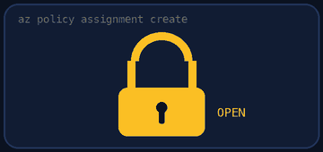
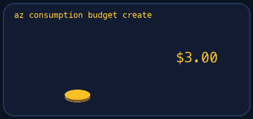
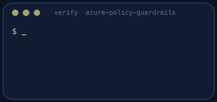
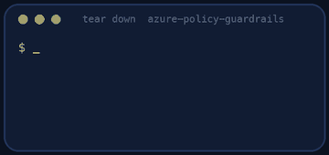

<p align="center"></p>

| | |
|-|-|
| **Time** | 90-105 min |
| **Cost** | free (policies, budgets and locks cost nothing; a test storage account costs cents) |
| **You need** | An Azure subscription where you can assign policies and create resources, the Azure CLI (`az login` done), Python 3 and a terminal |

## How this lab works

1. **Fork** this repository to your own GitHub account (button at the top right).
2. Clone **your fork** in your Ubuntu environment (WSL on Windows, your OrbStack machine on Mac).
3. Read the lab below (the same text is in [`LAB.md`](LAB.md)) and follow the mission.
4. Answer the questions in [`SUBMISSION.md`](SUBMISSION.md). Where a question asks for output, paste it in a code block. No screenshots needed.
5. Commit and push. Open the **Actions** tab of your fork (click *I understand my workflows, go ahead and enable them* the first time). The **Lab check** shows what is still missing.
6. When the check is green, **submit the URL of your fork** in the course platform.

> [!NOTE]
> The check only looks at your answers and any files the lab asks you to commit. Your instructor reads your work and may ask you to explain any line.

<p align="center"></p>

## 🎬 The situation

<p align="center"></p>

Beanie's three teams share one Azure subscription, and last month's bill had surprises. An intern left a GPU machine running over a long weekend. Three teams created resources that nobody can attribute to anyone, and when finance asked "whose is this?", the answer was a shrug. And a storage account appeared in a region the company's contracts do not allow for customer data.

You could send an e-mail asking people to be careful. You have probably sent that e-mail before. Rules that depend on people remembering do not work; rules that make the wrong thing **impossible to do** do. Azure has three tools for that, and they are free:

- **Azure Policy**: "every resource must have an owner tag", "only these regions", "only these VM sizes". A resource that breaks the rule is **refused** at creation.
- **Budgets**: a monthly amount and an alert at 80% and at 100%, so the surprise arrives on the 12th, not on the invoice.
- **Resource locks**: a `CanNotDelete` lock, so that even an Owner has to stop and remove the lock on purpose before deleting anything.

Today you build all three, on one resource group so that nothing outside it is touched, and then you try to break through them yourself.

> [!IMPORTANT]
> **Your mission**
> - Create the resource group `rg-guardrails` in `eastus`, tagged
> - Assign three built-in policies to it that **deny**: missing `owner` tag, wrong region, big VM sizes
> - Create a monthly budget with alerts at 80% and 100%
> - Lock the group against deletion
> - Try to create things the rules forbid, and read the errors
> - Tear down in the right order (the lock first) and prove it

**Time:** 90-105 min | **Cost:** free (a test storage account costs a few cents) | **You need:** an Azure subscription where you can assign policies (Owner or Resource Policy Contributor on the resource group), the Azure CLI (`az login` done), Python 3 and a terminal.

<p align="center"></p>

## Part 0 - Prepare

Fork this repository, clone your fork and run `./setup.sh`. It checks your login and prints the names to use. Then create the resource group:

```bash
az group create -n rg-guardrails -l eastus --tags lab=azure-policy-guardrails
```

> **Quota and capacity are normal in Azure.** This lab does not create virtual machines, so you should not meet `QuotaExceeded` or `SkuNotAvailable`. If you ever do (in this lab or the next), it is a subscription limit or a capacity shortage, nothing you did wrong: `az vm list-usage -l eastus -o table` shows your limits, and **Quotas > Compute > Request adjustment** in the portal asks for more, usually approved in minutes. Do not be afraid of it. It is a different kind of "no" from the one you are about to meet (`RequestDisallowedByPolicy`): learn to tell them apart.

<p align="center"></p>

## Part 1 - Look at what a policy is

<p align="center"></p>

```bash
az policy definition list --query "[?displayName=='Require a tag on resources'].{name:name, effect:policyRule.then.effect, params:parameters}" -o json
```

A **definition** says: "if the resource looks like X, then do Y". `Y` is the **effect**: `audit` (report only), `deny` (refuse), `modify` (fix it automatically), `append`, `disabled`. An **assignment** attaches a definition to a **scope** (a management group, a subscription, a resource group) and fills in its parameters. Built-in definitions exist for hundreds of common rules; you write a custom one only when none fits.

> [!NOTE]
> **Think** What is the difference between **RBAC** and **Policy**? RBAC answers "who may do what". Policy answers "what is allowed to exist". An Owner can still be refused by a policy. Why are both needed?

<p align="center"></p>

## Part 2 - The three guardrails

Assign these built-in policies to the **resource group** (scope `/subscriptions/<id>/resourceGroups/rg-guardrails`), each with a name starting with `guard-` and a readable display name:

| Definition | Parameter | Effect |
|------------|-----------|--------|
| **Require a tag on resources** (`871b6d14-10aa-478d-b590-94f262ecfa99`) | `tagName` = `owner` | deny |
| **Allowed locations** (`e56962a6-4747-49cd-b67b-bf8b01975c4c`) | `listOfAllowedLocations` = `["eastus"]` | deny |
| **Allowed virtual machine size SKUs** (`cccc23c7-8427-4f53-ad12-b6a63eb452b3`) | `listOfAllowedSKUs` = a short list of small sizes (for example `Standard_B1s`, `Standard_B1ms`, `Standard_B2s`, `Standard_D2s_v3`) | deny |

```bash
az policy assignment create --help
az policy assignment list -g rg-guardrails -o table
```

(Console-first is fine too: Azure portal > Policy > Assignments > Assign policy.) Note that assignments take **minutes** to start enforcing. A policy is not a firewall rule with instant effect: it is evaluated by a service that must first learn about the new assignment.

<p align="center"></p>

## Part 3 - The budget

A budget with the amount of 20 US dollars a month on the resource group, with notifications at **80%** and **100%** of actual cost, sent to an e-mail address. Portal: **Cost Management > Budgets > Add**, scope the resource group. From the CLI, budgets are created through the REST API (`az rest --method put` on `.../providers/Microsoft.Consumption/budgets/guard-budget?api-version=2023-05-01`; the body has `category`, `amount`, `timeGrain`, `timePeriod` with a `startDate` on the first of the current month, and a `notifications` map).

> [!NOTE]
> **Think** A budget does not stop anything. At 100% it sends an e-mail. Which of the following would actually stop a runaway cost: an action group that deallocates machines, a policy that denies big sizes, a lower subscription quota? Which one is the policy you just assigned?

<p align="center"></p>

## Part 4 - The lock

```bash
az lock create --name guard-lock --lock-type CanNotDelete -g rg-guardrails
```

A `CanNotDelete` lock says: anyone may read and change resources in this group, but nobody may **delete** them, not even an Owner, until the lock itself is removed. Locks are independent of RBAC. Remember this when you reach teardown.

<p align="center"></p>

## Part 5 - Try to break through

Wait a few minutes for the policies, then try to create a storage account (it costs nothing until you store something) in each of these situations and read the error:

```bash
# 1. no owner tag
az storage account create -g rg-guardrails -n stguard<your-initials><random> -l eastus --sku Standard_LRS
# 2. a forbidden region (even with the tag)
az storage account create -g rg-guardrails -n stguardwest<random> -l westeurope --sku Standard_LRS --tags owner=me
# 3. everything right
az storage account create -g rg-guardrails -n stguardok<random> -l eastus --sku Standard_LRS --tags owner=me
# 4. now try to delete it
az storage account delete -g rg-guardrails -n stguardok<random> --yes
```

The first two fail with `RequestDisallowedByPolicy`, and the error names the policy assignment that refused. Case 3 works. Case 4 fails with `ScopeLocked`. Read each message: they are written to tell you which control said no. The same denials appear in the **Activity log** of the resource group, which is where an auditor would look.

> [!NOTE]
> **Predict** If you try case 1 immediately after creating the assignment, it may succeed. Why? What would that do to a rollout that depends on the policy being in force from minute zero?

<p align="center"></p>

## Part 6 - Prove it

<p align="center"></p>

```bash
./verify.sh
```

It reads your assignments (scope, definition, parameters, effect), your budget (amount, period, thresholds, contacts) and your lock, and then **tries to break through** with a storage account without the tag, one in `westeurope`, and one correct, and finally tries to delete it. It keeps trying for up to 15 minutes because the policies need time to take effect. Fix what is red and run it again until it ends with **ALL CHECKS PASSED**. Paste the output into `SUBMISSION.md` **before** you tear down.

> [!TIP]
> **Stuck?** `The policy definition ... could not be found`: use the definition **name** (the GUID), not the display name. The "locations" check fails: the list must contain exactly `eastus`. The test account is created even without the tag: the assignment has not started yet, wait and run `./verify.sh` again; or its effect is `audit`. Budget creation says the start date is invalid: it must be the first day of the **current** month or later. `az policy assignment create` says `AuthorizationFailed`: you need Owner or Resource Policy Contributor on the resource group.

<p align="center"></p>

## Level up (optional)

- Add an `append` or `modify` policy that adds `environment=lab` to every resource automatically. Why is `modify` friendlier than `deny` for tags that people forget?
- Assign the same rules at the **subscription** scope with an **exclusion** for one resource group. What is the difference in blast radius?
- Write a custom policy definition (JSON) that denies storage accounts that allow public blob access. Test it against `az storage account create --allow-blob-public-access true`.
- Look at **Policy > Compliance** for your resource group. What does it say about resources that existed before the assignment?

<!-- teardown:start (generated by labs.py, do not edit) -->
## Tear down (mandatory)

<p align="center"></p>

Resources left behind cost money, keep doors open and pollute the next lab. Removing what you created is part of the job, so it is part of the submission: **you must prove it is gone**.

Do this **last**, after you have pasted your `verify` output into `SUBMISSION.md` (once you tear down, the lab can no longer be verified).

1. Run `./teardown.sh`. It removes the lock first, then the policy assignments, the budget and the resource group `rg-guardrails`.

Then run the proof:

```bash
./verify-teardown.sh
```

It prints a list of checks and must end with **TEARDOWN VERIFIED**. If it reports leftovers, remove them and run it again. Paste the full output in your submission.
<!-- teardown:end -->

<!-- submission:start (generated by labs.py, do not edit) -->
## 📬 Submission

Answer the questions in `SUBMISSION.md` in **your fork** (paste output in code blocks where asked), push, then submit the **URL of your fork**.

**Files to commit**

- `notes.md` with your commands (optional)

**Questions to answer**

1. Paste the policy assignments you created (name, definition, scope, effect). Which built-in definitions did you choose and why built-in rather than custom? What is the difference between the effects `deny`, `audit` and `modify`?
2. Paste the error Azure gave when you tried to create a resource without the `owner` tag, and the one for a forbidden region. Which part of the message names the policy that blocked you? Where would an auditor read this later (Activity log)?
3. Why did the new policy not block you immediately? How long did it take, and what does that tell you about relying on a policy during a rollout? What is the difference between policy and RBAC (what you may *do* vs what is *allowed to exist*)?
4. Paste your budget (amount, period, thresholds). What does a budget do when it is exceeded: stop spending or only notify? What would you add to actually stop a runaway cost (an action group, automation, a policy on SKUs)?
5. Paste the failed delete under the `CanNotDelete` lock. Who can remove a lock, and how does it differ from RBAC? Why must teardown remove the lock first?
6. Policy at the scope of a resource group, a subscription and a management group: what is inherited, what can be excluded, and which scope would you assign a company-wide rule to?
7. Azure quota and policy can both say "no". Explain how you tell a quota error (`QuotaExceeded`) from a policy error (`RequestDisallowedByPolicy`), and who you ask for help in each case.
8. Paste the output of `./verify.sh`. It must end with **ALL CHECKS PASSED**.
9. **Tear down.** Paste the output of `./verify-teardown.sh`. It must end with **TEARDOWN VERIFIED**.
<!-- submission:end -->
